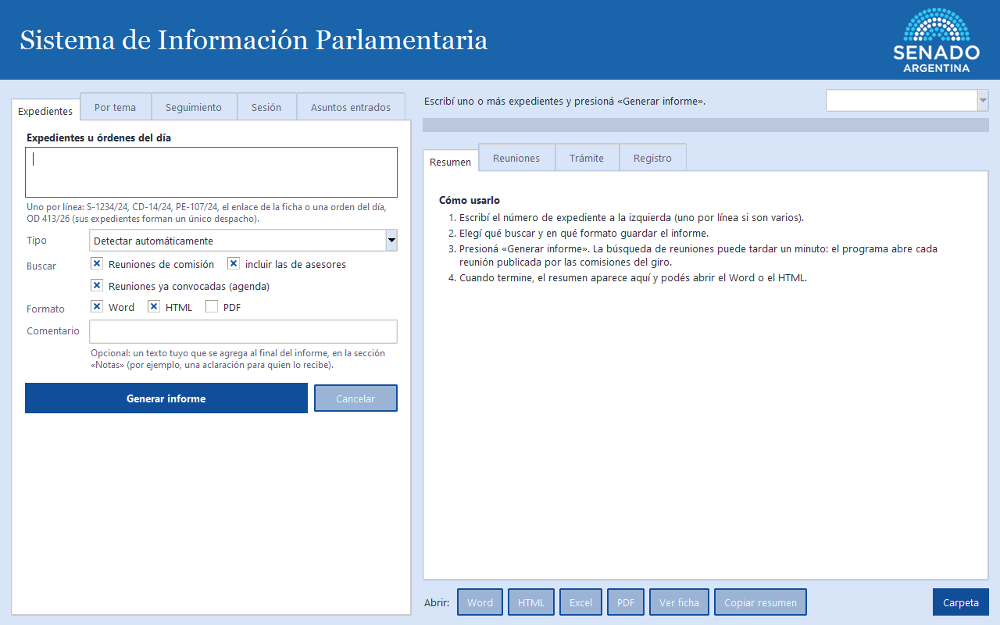
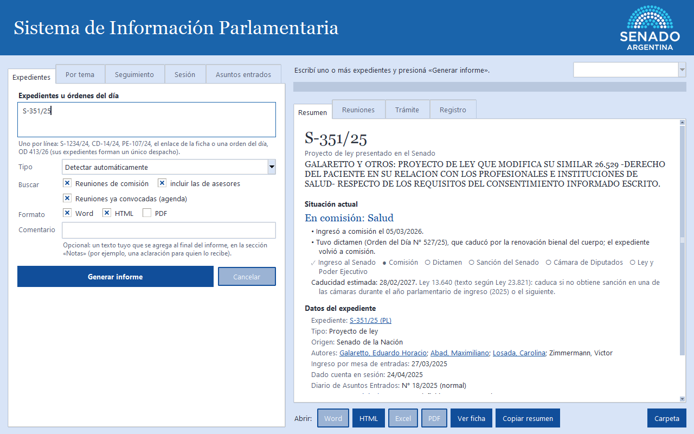
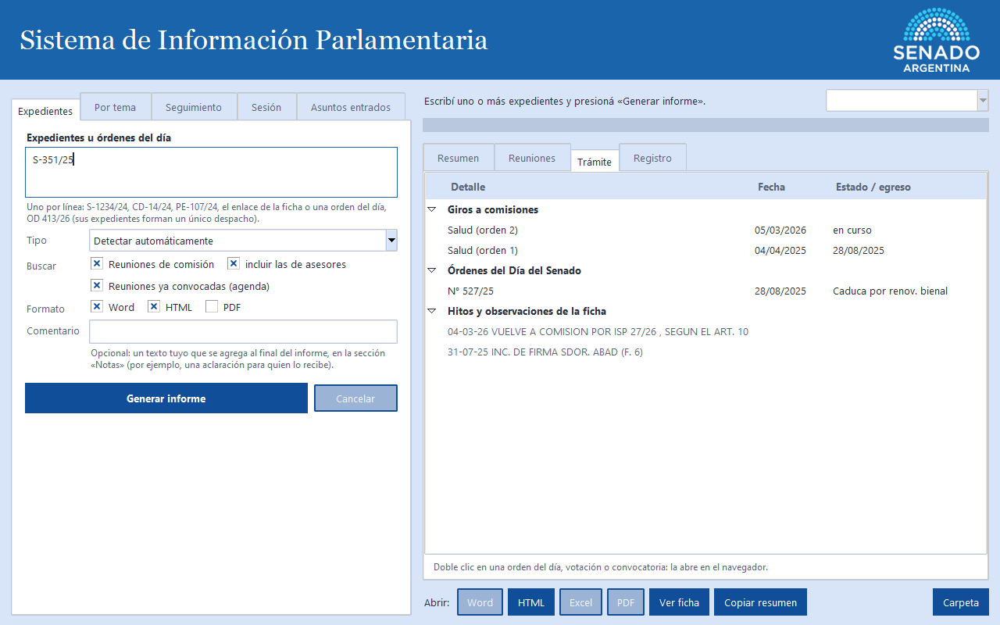
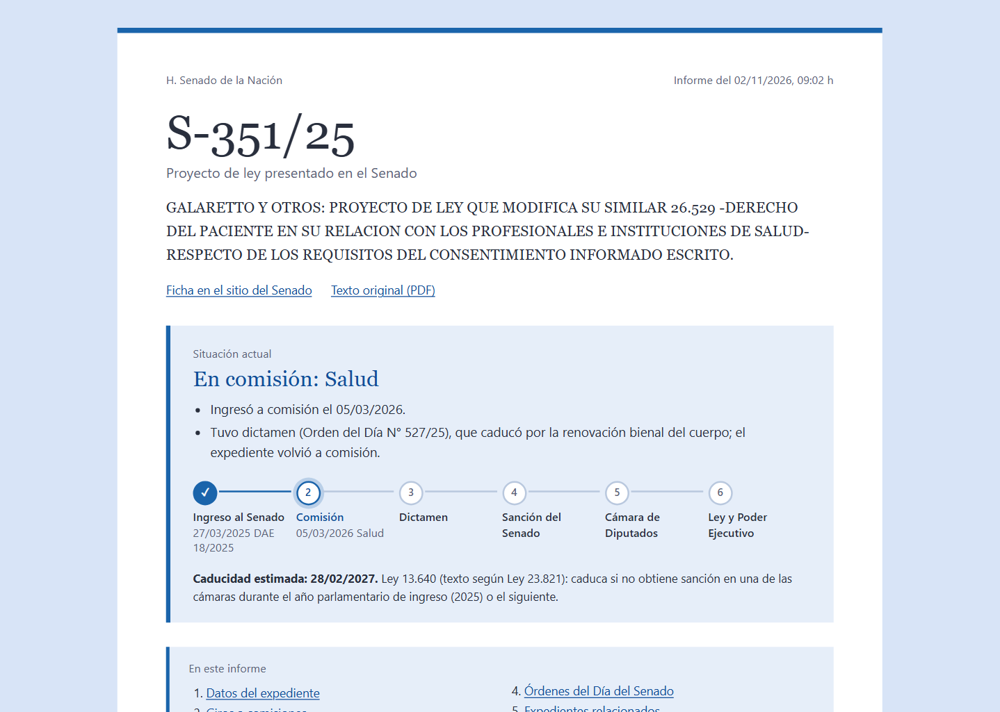
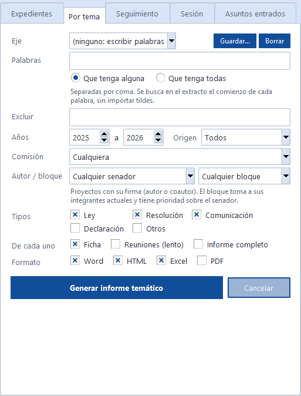
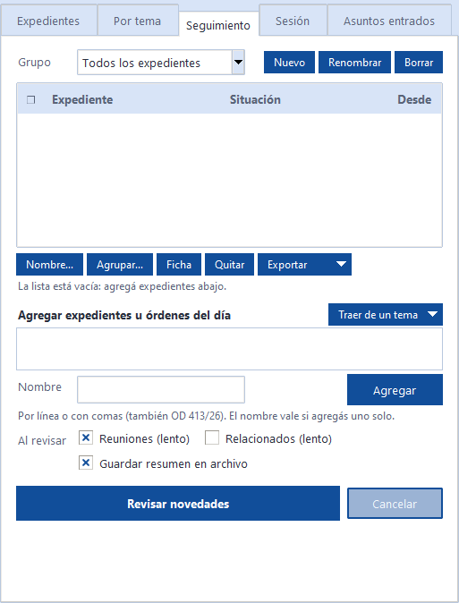
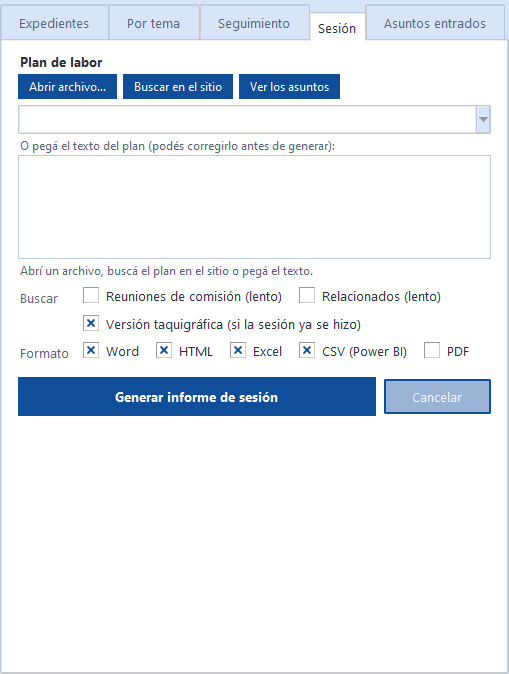
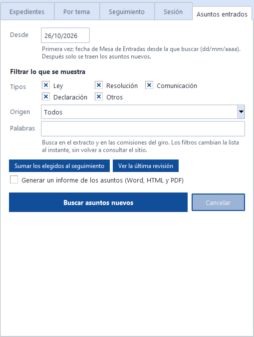
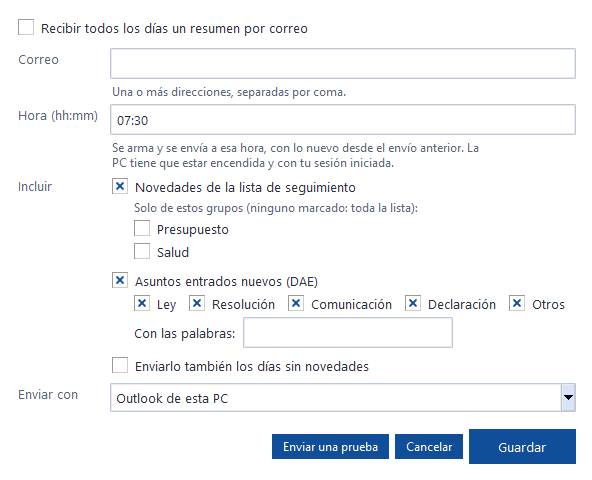

<!--
Contenido del manual de usuario. Lo compila manual/construir_manual.py (y el workflow «Manual de usuario»).

Convenciones:
  # Título            → capítulo nuevo (empieza en página nueva; «Anexo …» para los anexos)
  ## Título           → sección (figura en el índice general)
  >> texto            → nota al margen, junto al párrafo que sigue
  !!! consejo "Título"  /  !!! atencion "Título"  /  !!! paso "Título"   → recuadros (contenido con sangría de 4 espacios)
     → figura numerada
  {{readme: Título de sección}}            → copia esa sección del README.md (siempre la versión actual)
  {{readme-novedades}}                     → todas las secciones «Novedades de la versión …» del README
  {{version}}                              → versión actual (la que indica el README)
-->

# Antes de empezar

## Qué es el programa

>> Solo usa información pública de senado.gob.ar y hcdn.gob.ar.

El **Sistema de Información Parlamentaria** es un programa de escritorio que consulta por usted los sitios del Senado y de la Cámara de Diputados y arma informes listos para usar, en Word, HTML (se abre con el navegador), Excel o CSV. Lo que antes requería abrir muchas páginas —la ficha del expediente, las reuniones de comisión, las órdenes del día, las votaciones— el programa lo reúne en un solo documento.

Tiene cinco modos de trabajo, cada uno en una pestaña:

| Pestaña | Para qué sirve |
|---|---|
| **Expedientes** | El informe completo de uno o varios expedientes, o de una orden del día. |
| **Por tema** | Encontrar todos los proyectos sobre un tema, de un senador o de un bloque. |
| **Seguimiento** | Una lista de expedientes que se revisa seguido para saber qué cambió. |
| **Sesión** | El informe de una sesión a partir del plan de labor parlamentaria. |
| **Asuntos entrados** | Lo nuevo que ingresó en el Diario de Asuntos Entrados (DAE). |

!!! consejo "Cómo leer este manual"
    No hace falta leerlo de corrido. Cada capítulo explica un modo de trabajo, paso a paso. Las **notas al margen** resumen lo importante de cada párrafo, y los recuadros marcan consejos y advertencias. En el pie de cada página hay un enlace **«Volver al índice»**.

## Qué se necesita

>> Versión de este manual: {{version}}.

- Una PC con Windows y conexión a internet.
- El archivo **InformeExpediente.exe**, que le entrega el área que mantiene el programa (suele estar en una carpeta compartida de la red). No hace falta instalar nada.

## Abrir el programa por primera vez

>> Doble clic en el acceso directo del escritorio.

1. Haga doble clic en el acceso directo **InformeExpediente** del escritorio (o en el archivo `.exe`).
2. Si Windows muestra el aviso «Windows protegió su PC», haga clic en **Más información** y después en **Ejecutar de todas formas**. Aparece porque el programa no tiene firma digital; no es un virus.
3. Se abre la ventana principal.

!!! atencion "Si el antivirus lo bloquea"
    Pida a Sistemas que autorice el programa. No intente desactivar el antivirus por su cuenta.

## Las partes de la ventana

>> Izquierda: qué buscar. Derecha: el resultado.

- **Arriba**, la barra de menús: *Archivo*, *Herramientas*, *Enlaces útiles* y *Ayuda* (ver el capítulo «Menús y herramientas»).
- **A la izquierda**, las cinco pestañas de trabajo. En cada una se completa qué se quiere buscar y se presiona el botón azul grande.
- **A la derecha**, el resultado: un resumen con enlaces activos y otras pestañas (*Reuniones*, *Trámite*, *Registro*). Mientras trabaja, la barra de progreso avanza y el texto de arriba dice qué está consultando.
- **Abajo a la derecha**, los botones **Abrir**: Word, HTML, Excel, PDF, la ficha en el sitio del Senado, copiar el resumen y la carpeta donde se guardan los informes.

>> El botón «Cancelar» detiene una consulta larga.

Mientras el programa consulta, puede seguir usando la PC. Si una consulta tarda demasiado, presione **Cancelar**.

# Informe de un expediente

## Paso a paso

>> Pestaña «Expedientes».

!!! paso "En pocas palabras"
    Escriba el número → presione **Generar informe** → abra el Word o el HTML.

1. Abra la pestaña **Expedientes**.
2. En el cuadro **Expedientes u órdenes del día** escriba el número. Puede escribir varios, **uno por renglón**.
3. Deje **Tipo** en *Detectar automáticamente*: el programa averigua si es un proyecto de ley, de resolución, etc.
4. Elija qué buscar (reuniones de comisión, reuniones ya convocadas) y los formatos (Word, HTML, PDF).
5. Si quiere, escriba un **Comentario**: se agrega al final del informe, en la sección «Notas».
6. Presione **Generar informe** (o las teclas **Ctrl + Enter**).

>> Formas válidas de escribir un número.

El número se puede escribir de muchas maneras, todas válidas:

| Escriba… | Para… |
|---|---|
| `S-1234/24` | un proyecto del Senado |
| `CD-14/24` | un proyecto que viene de Diputados |
| `PE-107/24` | un mensaje del Poder Ejecutivo |
| `1370-S-2020` | el formato con guiones |
| `OD 413/26` | una orden del día (todos sus expedientes juntos) |
| el enlace de la ficha | copiado del sitio del Senado |

!!! consejo "¿Cuánto tarda?"
    Sin reuniones de comisión, unos segundos. Con reuniones, entre medio minuto y un par de minutos la primera vez; después es mucho más rápido porque el programa recuerda lo que ya leyó.

## Leer el resultado

>> El resumen aparece en la ventana, con enlaces activos.

El resumen empieza por el número y el extracto. Lo más importante es la **Situación actual** (en la figura, «En comisión: Salud»), con una línea de pasos del trámite que marca con un punto dónde está el expediente:

> ✓ Ingreso al Senado · ● Comisión · ○ Dictamen · ○ Sanción del Senado · ○ Cámara de Diputados · ○ Ley y Poder Ejecutivo

>> La caducidad estimada es orientativa.

Debajo figura la **caducidad estimada** y los datos del expediente (tipo, origen, autores, fechas, número de DAE). Los textos subrayados son enlaces: un clic abre la página correspondiente en el navegador.

!!! atencion "Antes de usar la caducidad en un trámite oficial"
    La caducidad que calcula el programa es una estimación. Verifíquela con la Dirección de Mesa de Entradas.

## Reuniones y trámite

>> Doble clic abre la nota de la reunión.

La pestaña **Reuniones** lista las reuniones de comisión en que se trató el expediente. Un **doble clic** abre la nota de la reunión; con el **clic derecho** puede abrir la versión taquigráfica, el video o copiar el enlace.

La pestaña **Trámite** muestra los giros a comisiones y los movimientos, con sus fechas:

## El informe en Word y HTML

>> Botones «Abrir» de abajo.

Al terminar, use los botones de abajo: **Word** abre el documento para editar o imprimir; **HTML** lo abre en el navegador, con un índice navegable; **PDF**, listo para enviar o archivar; **Carpeta** abre la carpeta donde quedan guardados. Así se ve el informe en HTML:

## Qué incluye el informe

>> Referencia completa, tomada del README.

{{readme: Qué incluye el informe}}

# Informe por tema

## Para qué sirve

>> Pestaña «Por tema».

Encuentra **todos los expedientes** sobre un tema, de un senador o de un bloque, y arma un informe con la etapa en que está cada uno. Sirve, por ejemplo, para responder «¿qué proyectos hay sobre universidades en 2025 y 2026?».

## Paso a paso

>> Elija un eje o escriba palabras.

1. Elija un **Eje** (por ejemplo «Salud»): completa solo las palabras. O escriba sus propias **Palabras**, separadas por coma.
2. Indique si el extracto tiene que tener **alguna** o **todas** las palabras.
3. Si quiere dejar afuera proyectos que mencionen otras palabras, escríbalas en **Excluir**.
4. Ajuste los **Años**, el **Origen**, la **Comisión** y los **Tipos**. Por defecto se buscan ley, resolución y comunicación; las declaraciones quedan afuera porque son muy numerosas.
5. Si quiere, elija un **senador** (escriba el apellido y elíjalo de la lista) o un **bloque**.
6. En **De cada uno** deje marcada *Ficha* (recomendado, para saber la etapa de cada expediente). En **Formato** elija Word, HTML, Excel o PDF.
7. Presione **Generar informe temático**.

>> Doble clic en la lista abre la ficha.

La lista de expedientes aparece en la pestaña *Expedientes* del resultado. Un doble clic abre la ficha; con el clic derecho puede generar el informe completo de uno o agregarlo a la lista de seguimiento.

!!! consejo "Cómo busca las palabras"
    No distingue tildes ni mayúsculas y busca el **comienzo** de cada palabra: «universidad» encuentra «universidades», pero «penal» no encuentra «despenalizar».

!!! atencion "Búsquedas largas"
    Un eje de seis palabras en dos años puede tardar entre uno y tres minutos. Para períodos largos, acote por comisión o por tipo.

## Guardar un eje propio

>> Los ejes se pueden compartir con el equipo.

Con **Guardar…** se guardan las palabras, exclusiones y comisión actuales con un nombre, para usarlas otra vez. **Borrar** elimina el eje elegido. Para que todo el equipo use los mismos ejes, pida a quien mantiene el programa que distribuya el archivo `ejes.json`.

## El Excel

>> Los totales se recalculan solos.

El Excel trae una fila por expediente, con filtros y enlaces, y una hoja *Resumen* cuyos totales se recalculan si se filtran o borran filas.

# Lista de seguimiento

## Para qué sirve

>> Pestaña «Seguimiento».

Arma una lista de expedientes para revisar seguido. Al presionar **Revisar novedades**, el programa consulta cada uno y avisa qué cambió desde la última vez: un giro nuevo, un dictamen, una votación, una sanción, una reunión convocada, la caducidad cercana, entre otros.

## Agregar expedientes

>> Uno por renglón o separados por coma.

1. En **Agregar expedientes u órdenes del día** escriba uno o más números (uno por renglón o separados por coma).
2. Si agrega uno solo, puede ponerle un **Nombre** propio («Ley de financiamiento universitario»).
3. Presione **Agregar**.

>> «Traer de un tema» suma los de un eje.

También puede usar **Traer de un tema** para sumar todos los expedientes de un eje temático o de la última búsqueda por tema.

## Grupos

>> Los grupos ordenan la lista.

Arriba de la lista, el selector **Grupo** filtra lo que se ve. Con **Nuevo**, **Renombrar** y **Borrar** se administran los grupos; con **Agrupar…** se mueven los expedientes marcados a un grupo. Las casillas de la primera columna sirven para marcar varios a la vez; **Quitar** saca de la lista los marcados.

## Revisar novedades

>> La primera revisión solo guarda el estado.

1. Presione **Revisar novedades**.
2. El resumen de cambios aparece a la derecha. Si está marcado *Guardar resumen en archivo*, queda también un HTML en la carpeta de informes.
3. La columna **Desde** indica la fecha del último movimiento.

!!! consejo "La primera vez"
    La primera revisión de cada expediente solo guarda su estado («Primera revisión»). Las novedades aparecen a partir de la segunda.

## Expedientes relacionados

>> Opcional: hace la revisión más lenta.

Si marca **Relacionados (lento)**, el programa busca también los expedientes que se dictaminaron o se trataron junto con cada uno, o que se tuvieron a la vista. Cuando aparece uno nuevo, la revisión lo avisa así:

> Expediente relacionado nuevo: S-865/26 — Dictaminado en conjunto (Orden del Día N° 366/26) (Con dictamen de comisión).

## Exportar la lista

>> Excel o PDF, con grupos y situación.

El botón **Exportar** guarda la lista (o el grupo que se está viendo) en:

- **Excel**: una hoja con todos los expedientes, con filtros, y una hoja por grupo. Trae el número, el nombre, los grupos, la situación, el extracto y el último movimiento.
- **PDF**: una tabla por grupo, lista para imprimir o enviar.

# Informe de sesión

## Para qué sirve

>> Pestaña «Sesión».

A partir del **plan de labor parlamentaria**, arma un único informe con cada asunto en el orden de tratamiento y la ficha de sus expedientes. Además genera un CSV para el tablero de sesiones (Power BI).

## Paso a paso

>> Tres formas de cargar el plan.

1. Cargue el plan de labor de una de estas tres formas:
    - **Abrir archivo…**: un Word, PDF o texto que tenga en la PC;
    - **Buscar en el sitio**: lista los planes publicados por el Senado; elija uno de la lista;
    - pegue el texto en el cuadro.
2. Presione **Ver los asuntos** para comprobar lo que entendió el programa, antes de consultar nada. Si algo está mal, corrija el texto en el cuadro.
3. Marque **Versión taquigráfica** si la sesión ya se hizo: suma el desenlace y las votaciones. **Relacionados (lento)** agrega, en la ficha de cada expediente, los tratados en conjunto o tenidos a la vista.
4. Elija los formatos y presione **Generar informe de sesión**.

!!! atencion "Versión taquigráfica"
    La lectura de la versión taquigráfica es automática. El informe lo aclara; revise los puntos importantes contra el texto oficial.

## Informe de una orden del día

>> Escriba «OD 366/26» en la pestaña Expedientes.

Para el informe de una sola orden del día no hace falta el plan: escriba, por ejemplo, `OD 366/26` en la pestaña **Expedientes**. Sus expedientes forman un único despacho.

# Asuntos entrados

## Para qué sirve

>> Pestaña «Asuntos entrados».

Lee el **Diario de Asuntos Entrados** (DAE) digital del Senado desde una fecha y, en las consultas siguientes, trae solo lo nuevo. Permite ver de un vistazo qué ingresó y sumar al seguimiento lo que interesa.

## Paso a paso

>> La fecha solo se usa la primera vez.

1. En **Desde** escriba la fecha de partida (dd/mm/aaaa). Solo se usa la primera vez; después se traen los asuntos nuevos.
2. Presione **Buscar asuntos nuevos**.
3. Use los filtros **Tipos**, **Origen** y **Palabras** para achicar la lista: cambian al instante, sin volver a consultar el sitio.
4. Marque los que le interesen y presione **Sumar los elegidos al seguimiento**.

>> El informe es opcional.

Si necesita un documento, marque *Generar un informe de los asuntos (Word, HTML y PDF)* antes de buscar. **Ver la última revisión** vuelve a mostrar el resultado anterior.

# Resumen diario por correo

## Para qué sirve

>> Opcional: cada usuario lo configura en su PC.

El programa puede mandarle todos los días un correo con las **novedades de su lista de seguimiento** y los **asuntos entrados nuevos**, para tenerlos al empezar el día sin abrir el programa.

## Paso a paso

>> Herramientas → Resumen diario por correo…

1. Abra el menú **Herramientas → Resumen diario por correo…**
2. Marque **Recibir todos los días un resumen por correo**.
3. Escriba su **correo** (puede poner varios, separados por coma) y la **hora** de envío, por ejemplo `07:30`.
4. Elija qué **incluir**: las novedades del seguimiento (de toda la lista o solo de los grupos que marque) y los asuntos entrados, con los tipos y las palabras que le interesen.
5. En **Enviar con** deje *Outlook de esta PC*: usa su cuenta de correo, sin contraseña.
6. Presione **Enviar una prueba** y revise que el correo llegó.
7. Presione **Guardar**.

!!! atencion "La PC tiene que estar encendida"
    El correo se arma y se envía desde su PC a la hora elegida. Si la PC está apagada o sin su sesión iniciada, ese día no sale.

!!! consejo "No le quita novedades a la ventana"
    El correo lleva su propio registro. Lo que le avisa por correo también lo va a ver cuando presione **Revisar novedades** en la ventana.

>> Para dejar de recibirlo, desmarque la casilla.

Para dejar de recibirlo, vuelva a abrir la ventana, desmarque la primera casilla y presione **Guardar**.

# Menús y herramientas

## Archivo

>> Cambiar dónde se guardan los informes.

- **Generar informe** (Ctrl + Enter): lo mismo que el botón azul de la pestaña.
- **Abrir carpeta de informes** y **Cambiar carpeta de informes…**: dónde se guardan los Word, HTML y Excel.
- **Salir**.

## Herramientas

>> Úselas cuando algo falla.

- **Resumen diario por correo…**: ver el capítulo anterior.
- **Usar caché**: recuerda las páginas ya leídas para que las consultas repetidas sean más rápidas. Conviene dejarla marcada.
- **Guardar las páginas descargadas (diagnóstico)** y **Abrir carpeta de diagnóstico**: sirven para enviar a quien mantiene el programa lo que el programa vio, cuando un informe sale raro.
- **Vaciar caché**: borra lo guardado y obliga a leer todo de nuevo. Úsela si ve datos viejos.

## Enlaces útiles y Ayuda

>> Accesos directos a los sitios oficiales.

**Enlaces útiles** abre en el navegador los buscadores de proyectos del Senado y de Diputados, la Constitución Nacional, los reglamentos de ambas cámaras, las versiones taquigráficas, las votaciones nominales y los planes de labor.

**Ayuda** tiene este **Manual de usuario**, un resumen de cómo funciona el programa, **Buscar actualizaciones** y la versión instalada.

## Versiones nuevas

>> El programa avisa solo.

Al abrir, una vez por día, el programa se fija si hay una versión más nueva. Si la hay, pregunta **«¿Querés instalarla ahora?»**: con **Sí**, la descarga, se cierra, se actualiza y se vuelve a abrir solo. Con **No**, no vuelve a preguntar por esa versión (puede instalarla después desde *Ayuda → Buscar actualizaciones*).

!!! atencion "Si el programa está en una carpeta compartida"
    Si no tiene permiso para escribir en la carpeta del programa, el aviso ofrece abrir la página de descarga. Avise a quien mantiene el programa.

## Dónde quedan los archivos

>> Una carpeta por pestaña.

Dentro de la carpeta de informes, cada pestaña guarda sus archivos en su propia carpeta: **Expedientes**, **Por tema**, **Seguimiento**, **Sesión** y **Asuntos entrados**. El botón **Carpeta** abre la carpeta del último informe.

# Si algo no funciona

## Problemas frecuentes

>> Antes de avisar, pruebe estos pasos.

{{readme: Si algo no funciona}}

!!! consejo "Para pedir ayuda"
    Anote el número de expediente, la pestaña que usaba y el mensaje que apareció. Si puede, envíe la carpeta de diagnóstico (*Herramientas → Abrir carpeta de diagnóstico*).

# Anexo A. Novedades por versión

## Cambios recientes

>> Tomado del README de esta versión.

{{readme-novedades}}

# Anexo B. Glosario

## Términos usados en el programa

>> Definiciones breves, en lenguaje llano.

**Expediente.** El número con que se identifica un proyecto o una comunicación oficial (por ejemplo, S-351/25: presentado en el Senado, número 351, año 2025).

**Giro.** El envío de un expediente a una o más comisiones para que lo estudien.

**Dictamen.** La opinión de la comisión sobre el proyecto. Se imprime en una **Orden del Día (OD)**.

**Orden del Día (OD).** El documento impreso con uno o más dictámenes, que queda en condiciones de ser tratado en el recinto.

**Plan de labor.** La lista de temas que el Plenario de Labor Parlamentaria acuerda tratar en una sesión.

**DAE.** El Diario de Asuntos Entrados: la lista de los asuntos que ingresan al Senado.

**Versión taquigráfica (VT).** La transcripción oficial de lo dicho en una sesión o reunión.

**Media sanción.** La aprobación por una de las dos cámaras; el proyecto pasa a la otra.

**Caducidad.** El vencimiento de un proyecto que no obtuvo sanción en el plazo que fija la ley.

**Caché.** La memoria del programa con las páginas ya leídas, para no pedirlas otra vez.

# Anexo C. Uso avanzado

## Línea de comandos

>> Solo para quien administra el programa.

Esta sección es para quien mantiene o automatiza el programa; no es necesaria para el uso diario.

{{readme: Línea de comandos}}
